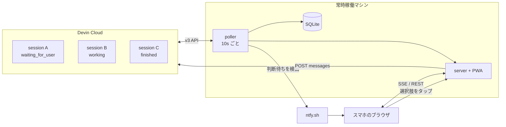
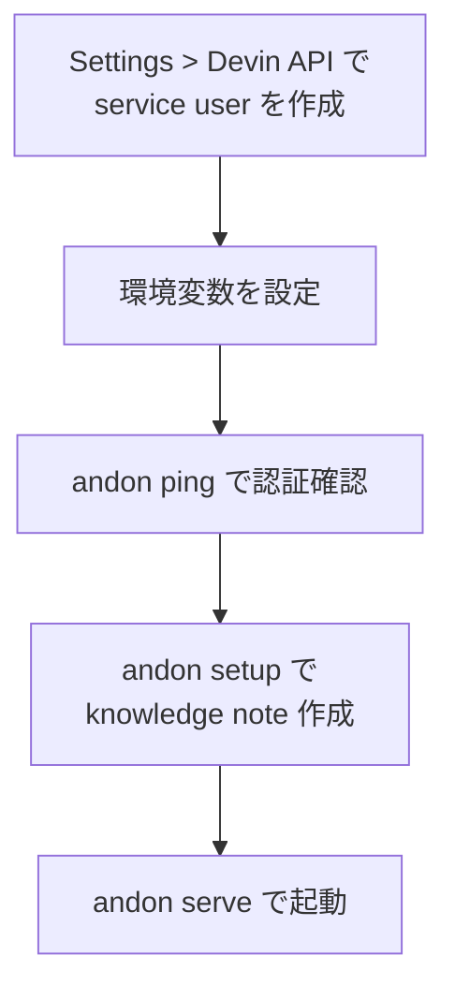
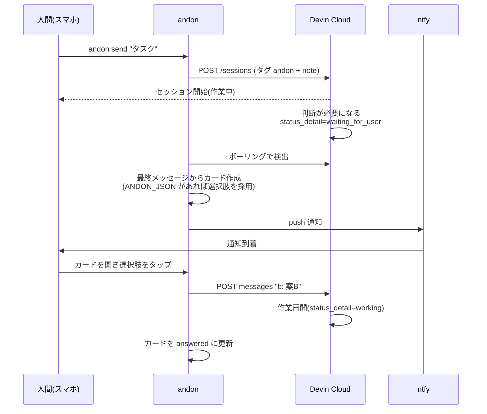
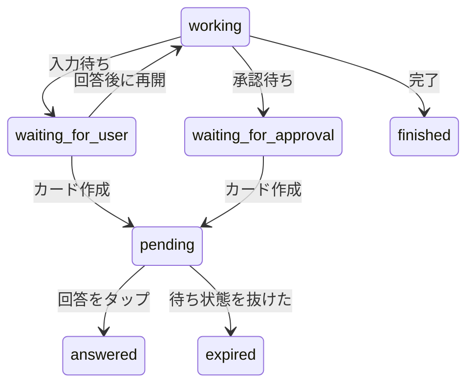
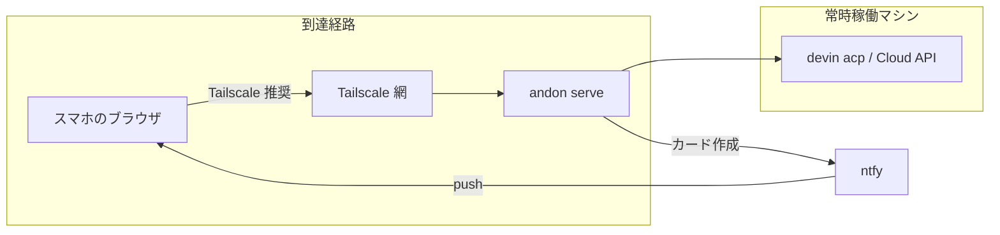
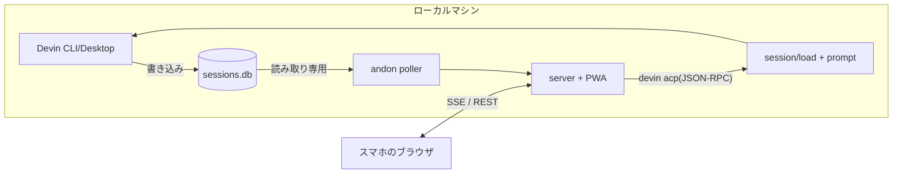

# andon 利用ガイド

andon は Devin セッション群の「行灯」である。各セッションの状態をカードで一覧し、人間への判断要求(`waiting_for_user`)を選択肢つきのカードとして届ける。人間のやることは、届いたカードの図を見て、選択肢をタップすることだけである。

## 全体像



andon が行うのは三段である。検出(ポーリング)→ 提示(カード・通知)→ 中継(回答をメッセージとして送信)。セッションの実行そのものには関与しない。

## セットアップ

必要なものは Devin API キーと組織 ID だけである。



1. Devin の **Settings > Devin API** で service user を作り、API キー(`cog_` 始まり)を取得する。必要な権限は `ViewOrgSessions`・`ManageOrgSessions`・`UseDevinSessions`。
2. 環境変数を設定する。

   ```sh
   export DEVIN_API_KEY=cog_...
   export DEVIN_ORG_ID=org-...     # Settings > Devin API の上部に表示される
   export ANDON_TOKEN=なにか長い文字列   # PWA/API の認証。推奨
   ```

3. `andon ping` で認証が通るか確認する。principal の JSON が返ればよい。
4. `andon setup` を実行する。カード規約(ANDON_JSON)を教える knowledge note が組織に作成され、ID がローカル DB に保存される。以後 `andon send` で作るセッションに自動添付される。
5. `andon serve` で起動する。既定では `127.0.0.1:8787` で待つ。

スマホから見る場合は、常時稼働マシンを Tailscale 等で到達可能にしておく(`ANDON_BIND=0.0.0.0:8787` + `ANDON_TOKEN` 必須、または tailscale アドレスにバインド)。ブラウザの「ホーム画面に追加」でアイコンから standalone 表示で開ける(manifest 配信済み)。

## 日常の使い方



### セッションを作る

```sh
andon send "containers リポジトリの builder を調査して報告して"
```

`andon` タグが付き、ポーリング対象になる。Devin 側の UI や Slack から作ったセッションは管理対象外である(タグがないため)。既存セッションを対象に入れたい場合は Devin アプリで `andon` タグを付けるか、タグ絞り込みを外す運用を検討する(現状はタグ必須)。

### 判断が届く

セッションが入力待ちになると、最大 `ANDON_POLL_INTERVAL`(既定 10 秒)後にカードが現れ、ntfy 設定時は push 通知が飛ぶ。通知のリンクまたは andon の画面を開くと、ページ先頭に判断待ちカードが並ぶ。

### カードを読んでタップする

カードの構成は次の通りである。

```
┌─────────────────────────────────────┐
│ セッション名 · 3m 前                 │  ← 出自と経過時間
│ 実装方針の選択                        │  ← title
│ ────────────────────────────────    │
│ API の認証方式を2案で検討した。        │  ← summary / 最終メッセージ
│ [mermaid 図解]                       │  ← diagram(あれば)
│ ┌─────────────────────────────────┐ │
│ │ a: JWT セッショントークンで実装   │ │  ← 選択肢ボタン
│ ├─────────────────────────────────┤ │
│ │ b: パスキーで実装                │ │
│ └─────────────────────────────────┘ │
│ ┌──────────────────────────┐ ┌────┐ │
│ │ 自由入力で回答…           │ │送信│ │  ← 自由入力
│ └──────────────────────────┘ └────┘ │
└─────────────────────────────────────┘
```

- Devin が ANDON_JSON 指令を出したカードは、件名・要約・図解・選択肢がそのまま反映される。
- 指令がない質問は、最終メッセージの抜粋と汎用選択肢(承認 / 却下 / 方針を変えて)で作られる。
- 選択肢でも自由入力でも、回答はそのまま Devin へのメッセージとして送られる。
- `承認待ち (safe mode)` のカードには回答欄がなく、代わりに「Devin で開く」リンクが出る。safe mode の承認は API から行えないため、Devin アプリ側で操作する。

## 状態の読みかた

セッション一覧のドットとカード状態は次の対応である。



| 表示 | 意味 | 要操作 |
|---|---|---|
| 橙ドット `working` | 作業中 | なし |
| 赤ドット `waiting_for_user` | 入力待ち | カードで回答 |
| 赤ドット `waiting_for_approval` | safe mode 承認待ち | Devin アプリで承認 |
| 緑ドット `finished` | 完了 | なし |
| 灰ドット | suspended / error 等 | Devin アプリで確認 |

`expired` になったカードは、Devin 側の UI で直接回答した場合など、andon 経由でなく待ち状態が解消されたものである。

## スマホから使う

andon の本体は常時稼働マシンで動かし、スマホはブラウザで見るだけの構成である。



### 到達させる

**Tailscale(推奨)**: マシンとスマホを同じ tailnet に入れ、マシンの tailscale IP で待ち受ける。WireGuard ベースの暗号化経路になるため、HTTP のままでも盗聴の心配がない。

```sh
export ANDON_BIND=0.0.0.0:8787
export ANDON_TOKEN=なにか長い文字列    # 必須
andon serve --source both
```

ブラウザで `http://<マシンのtailscale-IP>:8787/?token=<ANDON_TOKEN>` を開く。tailscale のアドレスだけに絞りたい場合は `ANDON_BIND=<tailscale-IP>:8787` でもよい。

**同一 LAN の場合**も同じ設定で `http://<LAN のIP>:8787` にアクセスする。どちらの場合も **`ANDON_TOKEN` 未設定のまま非ローカルアドレスにバインドすると無認証で誰でも回答注入できる**(起動時に警告が出る)。

**外部公開はしないこと**。TLS 終端なしの平文 HTTP + URL クエリのトークンという構成は、閉域網(Tailscale・LAN・SSH ポートフォワード)での利用を前提にしている。

### トークンの保存

最初に `?token=...` 付きで開くと、トークンはブラウザの localStorage に保存され、以後はクエリなしの URL で使える。通知のリンクやブックマークは `?token=` 付きで保存しておくのが手軽である。トークンを忘れたり別端末で開いたりした場合は、401 でパスワード入力ダイアログが出る。

### ホーム画面に追加(PWA)

manifest を配信しているので、アプリとして置ける。

- **iOS (Safari)**: andon を開く → 共有ボタン →「ホーム画面に追加」
- **Android (Chrome)**: andon を開く → メニュー →「ホーム画面に追加」(または「アプリをインストール」)

アイコンから開くとアドレスバーのない standalone 表示になり、カード一覧だけが画面いっぱいに使える。

### 画面の見方と操作

```
┌──────────────────────────────┐
│ andon    判断待ち 2   + 新規  │  ← ヘッダ(badge=未決カード数)
├──────────────────────────────┤
│ [判断カード pending が上から] │
│ [answered / expired は下]    │
├──────────────────────────────┤
│ SESSIONS                     │
│ ● セッション行 ...            │
└──────────────────────────────┘
```

- **判断カード**は画面先頭に pending から並ぶ。選択肢ボタンをタップすると即送信され、自由入力はテキストを書いて「送信」。回答が通るとカードは `answered` になる
- **`権限要求:` で始まるカード**は、エージェントがツール実行の許可を求めている ACP の権限要求。提示された選択肢(許可・拒否等)をタップすると実行が進む。自由入力で送るとキャンセル扱いになる
- **`+ 新規`**を押すと起動フォームが開く。タスク(必須)・作業ディレクトリ(省略可)・ソース(自動/ローカル/Cloud)を入れて「起動」。ローカルは ACP、Cloud は v3 API で作られる
- **セッション一覧**はドットの色が状態。ローカルセッション(`local:`)はリンクにならない
- 画面の更新は SSE でリアルタイムに行われ、切れていても30秒ごとに再取得する。ポーリング周期(`ANDON_POLL_INTERVAL`、既定10秒)までは一覧に反映されないことがある

### 通知から開く

ntfy の通知をタップしたときの遷移先は次の優先順である。

1. `ANDON_PUBLIC_URL` が設定されていればその URL(andon 自身)
2. なければセッションの URL(Cloud なら Devin アプリ、ローカルは遷移先なし)

スマホ運用では `ANDON_PUBLIC_URL=http://<マシンのtailscale-IP>:8787/?token=<ANDON_TOKEN>` と設定しておくと、通知タップ → andon が開く → カードをタップ、の最短動線になる。

## 通知(ntfy)

```sh
export ANDON_NTFY_TOPIC=andon-あなたの秘密のトピック名
```

ntfy.sh の場合、同じトピック名をスマホの ntfy アプリで Subscribe すると、判断待ちと承認待ちが push で届く。通知のタップ先は `ANDON_PUBLIC_URL` 設定時はその URL(andon 自身)、未設定ならセッションの Devin URL である。自前の ntfy サーバを使う場合は `ANDON_NTFY_BASE` で差し替える。

通知本文にはカードの抜粋(最大300文字)が含まれる。セッションの作業内容が ntfy サーバを経由することになるため、公開 ntfy.sh を使うときは推測しにくいトピック名にすること。機微な内容を流したくない場合は `ANDON_NTFY_BASE` で自前のサーバに切り替える。

## ローカル Devin(CLI/Desktop)を使う

Devin Cloud ではなく、ローカルマシンで動く Devin CLI/Desktop のセッションも監視できる。API キーは不要で、`~/.local/share/devin/cli/sessions.db` を直接読んで状態を推定する。回答の注入とセッション起動は `devin acp`(stdio JSON-RPC)経由で行い、credentials.toml の `windsurf_api_key` で認証するため **`devin auth login` は不要**である。ACP が使えない環境では `devin -r` にフォールバックする(こちらは CLI 側のログインが必要)。



### セットアップ

1. `andon serve --source local` で起動する。`--source both` にすると Cloud API と同時に監視する。起動時に `devin acp` への接続を試み、`[andon] devin acp 接続成功` と出れば注入・起動・権限カードがすべて使える。
2. `devin auth login` は ACP 経路では不要だが、`devin -r` フォールバックと `send --local`(CLI の `devin -p` 経路)では必要になる。

### セッションを作る

PWA の「+ 新規」ボタンから作るのが手軽である(POST /api/sessions)。タスクと作業ディレクトリを入れて「起動」を押すと、ACP の `session/new`+`session/prompt` で即座に起動する。CLI からは:

```sh
andon send --local --cwd ~/Projects/containers "builder を調査して報告して"
```

こちらは `devin -p` をバックグラウンド起動するため `devin auth login` が必要である。どちらの経路でも ANDON_JSON 規約はプロンプトに自動で添えられる。ターンが終わると andon が「入力待ち」を検出してカードを作る。

### 権限要求カード

ACP 接続中は、エージェントがツール実行の許可を求める `session/request_permission` が「権限要求: …」のカードとして届く。選択肢は Devin 側が提示したもの(許可・拒否等)がそのまま並び、タップすると ACP 応答が返って実行が進む。自由入力で送った場合はキャンセル扱いになる。

### 状態の読みかた(ローカル)

ローカルセッションの ID は `local:` 接頭辞付きで表示される。状態は sessions.db の内容とプロセスロックから推定される。

| 表示 | 意味 | 要操作 |
|---|---|---|
| `running/working` | Devin が作業中 | なし |
| `running/in_terminal` | 入力待ちだが端末/Desktop が開いている | 端末で応答(andon からは回答不可) |
| `suspended/waiting_for_user` | 入力待ちで注入可能 | カードで回答 |
| `suspended/interrupted` | プロセスがいないまま途中停止 | `devin -r` で手動再開 |

### どのセッションがカードになるか

ローカルセッションは `waiting_for_user` だけではカード化されない。カードになるのは「待機中」+ 次のいずれかである。

- `andon send --local` で起動した、または andon 経由の回答が一度でも通ったセッション(所有セッション)
- Devin が `ask_user_question` で質問を投げているセッション。質問文と選択肢がそのままカードになる
- 最終メッセージに ANDON_JSON 指令があるセッション

Desktop/TUI で開いたままのセッションはロックが残っているためカード化されない。Desktop を閉じるかプロセスが死んだあとに待機状態が残れば、andon から `-r` で引き継げる。

### 注意

- `devin -r` はターンが終わるまでプロセスが残る。回答の送信は「起動を確認できた」時点で完了扱いになる。ACP 経路ではこの待ちは発生しない
- `andon serve` 中は andon 自身の `devin acp` プロセスがセッションのロックを握るが、`in_terminal` とは表示されない(自プロセスは判定から除外)。一方 `andon sessions --local` は別プロセスのため、serve 中のセッションは `in_terminal` に見える
- sessions.db のスキーマは非公開の内部構造であり、CLI 更新で変わる可能性がある
- `ANDON_DEVIN_HOME` でデータディレクトリ、`ANDON_DEVIN_BIN` で実行ファイルの場所、`ANDON_DEVIN_CREDENTIALS` で credentials.toml の場所を変えられる

## トラブルシューティング

- **カードが現れない**: `andon poll` を手で回す。`sessions` タブに対象セッション自体が出ないなら `andon` タグが付いているか確認する。`status_detail` が `waiting_for_user` でも最終メッセージに Devin 発言がないケースではカードは作られない。
- **回答が送れない**: セッションが suspended に変わった可能性がある。メッセージ送信は自動 resume するはずだが、失敗時は Devin アプリ側で確認する。
- **ポーリングが失敗し続ける**: serve の標準エラーに `[andon] ポーリング失敗:` と出る。API キー・org ID・権限を `andon ping` で切り分ける。
- **選択肢が出ない・文字だけの質問になる**: Devin が ANDON_JSON を付けていない。`andon setup` 済みか、そのセッションに note が添付されているか(`andon send` 経由か)を確認する。
- **ローカルカードに回答できない**: `devin auth login` 未実施だと `devin -r` が失敗する。カードのセッションが `in_terminal` なら端末/Desktop で開いているため、そちらで応答する。
- **ローカルセッションが一覧に出ない**: `ANDON_LOCAL_DAYS` の期間外か、`ANDON_DEVIN_HOME` が実際のデータディレクトリと違う可能性がある。`andon sessions --local` で確認する。
